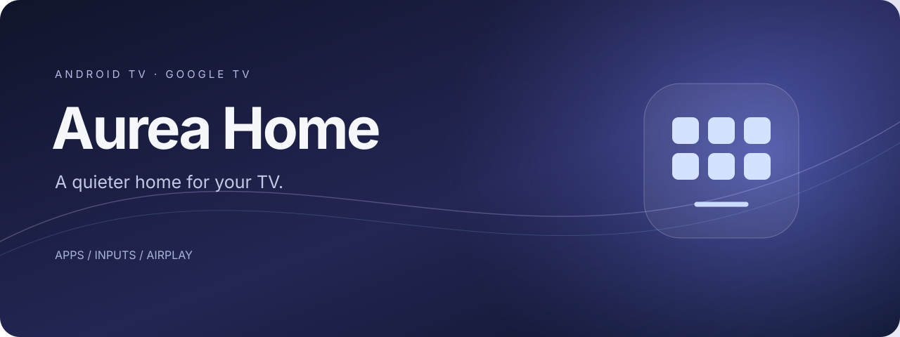
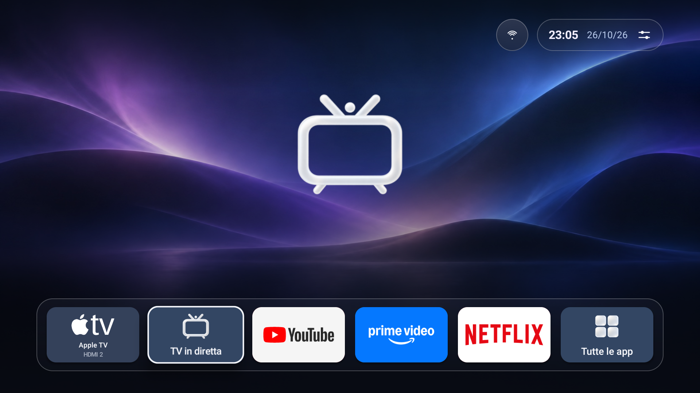
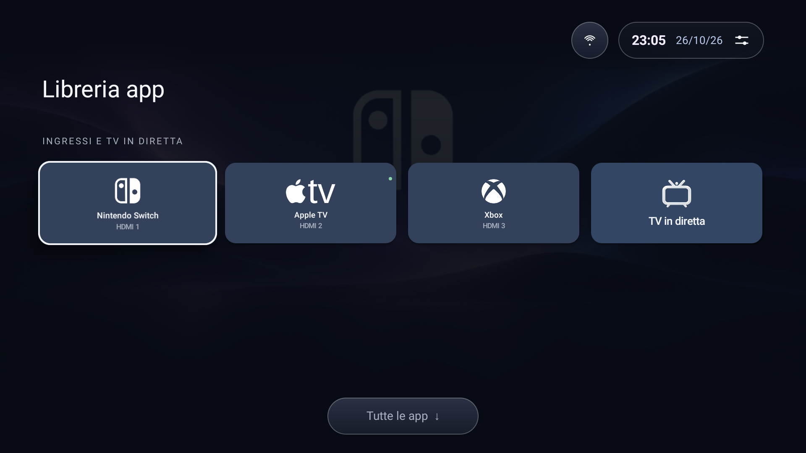
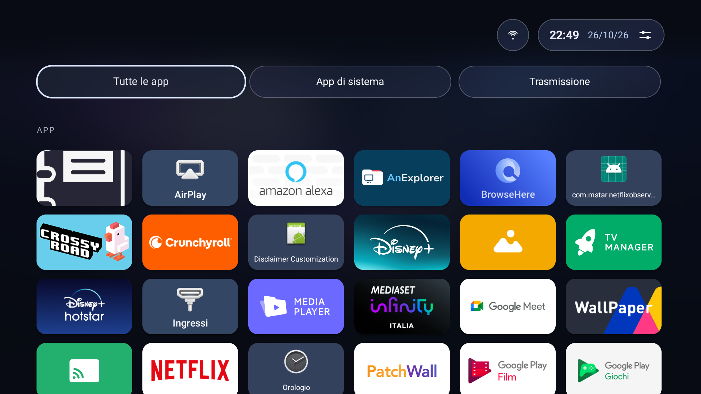
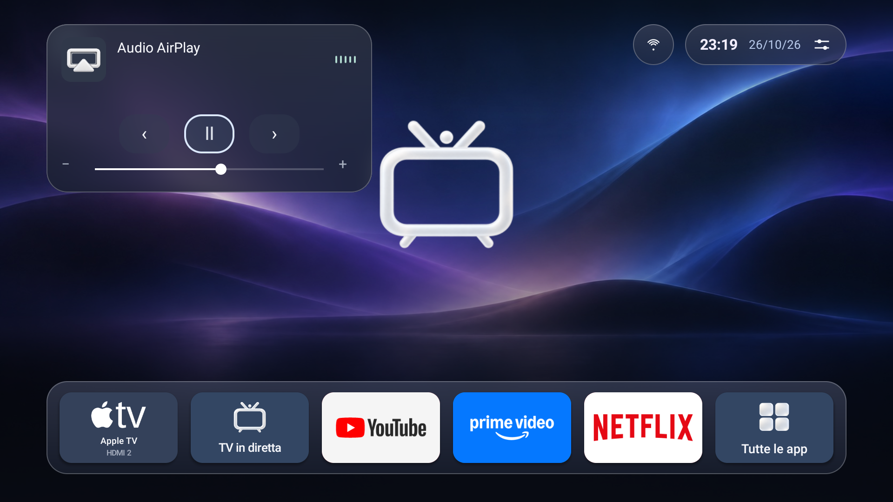

A remote-first Android TV launcher with a six-item dock, fullscreen artwork, fast input shortcuts, and an integrated AirPlay receiver. Built for the living room, with Italian and English throughout.

<a href="https://github.com/Xarber/MiTV-Home/releases/latest"><strong>Download APK</strong></a> · <a href="docs/INSTALL.md">Install & restore</a> · <a href="docs/BUILDING.md">Build it yourself</a> · <a href="https://github.com/Xarber/MiTV-Home/issues">Report an issue</a>

## Your TV, arranged your way

- **Six customizable positions.** Apps, individual HDMI inputs, Live TV, and Sources can move around. All Apps is available in position six.
- **Three landing points.** Dock → Inputs & Live TV → apps with All Apps, System Apps, and Casting categories. Longer grids scroll normally; dock edges keep horizontal focus inside the dock.
- **Fullscreen banners.** App artwork takes priority; source banners use centered device logos. Translucent surfaces and strong library shading keep controls readable. Popups capture and blur the current screen when opened; their backdrop is discarded on dismissal.
- **Remote ergonomics.** Hold OK on an item for its menu. Hold Back for Control Center. A downward All Apps hint leads from Inputs to the app grid.
- **Compact status.** Time, date, and an expanding, single-line network bubble.
- **Integrated AirPlay.** The receiver starts with Home and can remain active in the background. Audio uses a small upper-left circle with six volume-independent frequency bars, from bass to treble and a focused popup with playback/volume controls; supported video and screen mirroring open fullscreen.
- **Phone remote.** Scan the QR in Control Center to pair automatically. The code is also visible in the panel, which closes after pairing. Requests made while the panel is closed show a notification at the upper left.

 

Release status is reported by GitHub Actions. APK/AAB publication requires successful builds and validation of the exact source commit. See [documentation](docs/INDEX.md).

**Mac Music playback is unresolved. Experimental FairPlay handshake checks do not provide complete AirPlay 2 support.** iPad radio/local-library playback was reported working.

## Settings and diagnostics

About MiTV Home includes a permanent changelog, once-per-update highlights, source/license information and portable Home preferences. Triple-press its version to unlock developer diagnostics temporarily; navigation, backgrounding or 30 seconds without input locks access. Reports exclude credentials, network identity and media titles.

## Compatibility

The physical reference device is a Xiaomi MiTV-MOOQ0 running Android 10. HDMI routing and the picture-settings shortcut are device-specific; other TVs may use their system input picker. Existing apps and TV services are preserved. This repository contains no debloat script.

Android 8/API 26 or newer is required. CI compiles native libraries for ARMv7, ARM64, x86, and x86_64. Other TVs and Google TV devices need their own hardware validation.

AirPlay support comes from the integrated open-source receiver. Sender, codec, DRM, and network compatibility vary. This is not an Apple-certified product. Screen mirroring was tested on the reference TV; the compact audio indicator and focused expanded controls were also checked on the reference TV. Sender-specific artwork and track metadata still need broader validation.

The phone remote runs while Home is foreground. It tries HTTP port 80 first. Stock Android can restrict privileged ports; on the reference TV the working fallback is **8765**. The QR always contains the actual address. The QR includes a short-lived pairing code in its URL fragment, which the browser clears before pairing.

## Install

Get the APK from [Releases](https://github.com/Xarber/MiTV-Home/releases/latest), install it, and select MiTV Home as your Home app. See [Install & restore](docs/INSTALL.md) for ADB and rollback steps. Keep the original launcher installed.

For the macOS Music compatibility error and its system-audio workaround, see [Apple Music on macOS](docs/APPLE_MUSIC.md). Artwork colors are available when the sender supplies a cover.

## Development channels

| Branch | Automatic build | GitHub Release assets |
| --- | --- | --- |
| `main` | APK and AAB in parallel | Stable release only after all required checks succeed |
| `beta` | APK and AAB in parallel | Prerelease only after all required checks succeed |
| `testing` | No automatic build | Never |

Stable APKs use the project's signing key, stored in Actions secrets. Local debug APKs use a different key, so Android will not accept a stable APK as an update to a debug installation. Preserve preferences before switching signing identities.

## Credits & license

MiTV Home is a modified distribution of [jqssun/android-airplay-server](https://github.com/jqssun/android-airplay-server), extended with the launcher, input customization, phone remote, and integrated audio controls by Xarber, October 2026. Upstream history and notices are retained.

The receiver includes [UxPlay](https://github.com/FDH2/UxPlay), [FFmpeg](https://ffmpeg.org/), [libplist](https://github.com/libimobiledevice/libplist), [OpenSSL](https://www.openssl.org/), and [Oboe](https://github.com/google/oboe). QR codes use [ZXing](https://github.com/zxing/zxing). See [third-party notices](docs/THIRD_PARTY.md) and the [licensing decision](docs/decisions/0001-licensing-and-platform-scope.md). Original launcher modules use [AGPL-3.0](LICENSE); upstream [GPL-3.0](LICENSES/GPL-3.0.txt) and component notices remain.

Apple, AirPlay, Apple TV, Xbox, PlayStation, Nintendo Switch, Wii U, and other names/logos belong to their owners and identify devices or installed apps. This is an independent project.
